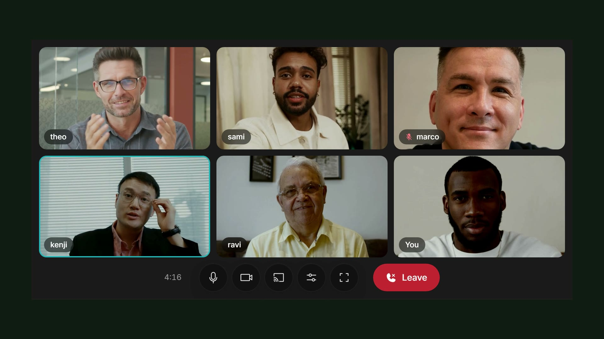

# Sonora

Chats, voice and video calls for friends and small groups. Everything runs on one Cloudflare Worker, and calls are peer-to-peer WebRTC on its own signalling: no vendor SDK or call service.

<p align="center">
  <a href="docs/media/sonora.mp4">
    
  </a>
  <br>
  <sub><a href="docs/media/sonora.mp4">▶ Watch the 39 s film</a>, cut from Sonora's real components</sub>
</p>

## What it does

- **Messaging.** DMs and group chats with optimistic send, replies, edits, deletes, reactions, and attachments with upload progress. Drafts are kept per chat.
- **Live state.** Presence, typing, read receipts (Sent → Seen) and unread counts. The chat list re-sorts as messages arrive.
- **Search and switching.** Ctrl+K jumps to any chat or friend and searches every message (SQLite FTS5).
- **Calls.** 1:1 and group voice and video for up to 6 people, with screen share, mute and camera toggles, a device picker, speaking indicators, and a mini call bar that stays as you move around the app.
- **Everywhere.** Light and dark themes, a phone layout designed on its own terms, and an installable PWA that rings for incoming calls through Web Push.

## How it works

```
browser ──HTTP──▶ Worker (Hono) ──▶ D1 (Drizzle)        users, chats, messages, FTS5 index
   │                   │       └──▶ Backblaze B2        attachments, served back through the Worker
   │                   ├──WS──▶ UserHub   (one Durable Object per user)   presence, typing, receipts, new messages
   │                   └──WS──▶ CallRoom  (one Durable Object per chat)   call signalling, who's in the call
   └────────── WebRTC media, peer to peer (mesh, ≤ 6) ──────────┘
```

- **One Worker** serves the app, the API and both WebSocket endpoints. In development, Vite runs that same Worker in workerd, with local D1 and Durable Objects.
- **Durable Objects with WebSocket Hibernation** hold the live connections. Each user has a `UserHub` that fans out their events. Each chat with a call has a `CallRoom` that relays offers, answers and ICE candidates. Idle connections let the objects sleep, so they don't keep them running.
- **Types run end to end.** The API's Hono routes and Zod schemas give the web client typed RPC. Message, call and push shapes live in `packages/shared`.
- **Attachments** go to Backblaze B2 through its S3 API, signed with `aws4fetch`. Reads go through the Worker, so auth and range requests both apply.

## Stack

| | |
|---|---|
| Server | Cloudflare Workers, Hono, Zod, D1 + Drizzle, Durable Objects, Backblaze B2, Web Push (VAPID) |
| Client | React 19, Vite 8, TanStack Router + Query, Tailwind v4, Base UI, Motion, Zustand |
| Tooling | Bun workspaces, TypeScript 7, Biome, Vitest (with the Workers pool) |

## Repository

```
apps/api        the Worker: modules for auth, chats, calls, files, friends, push, realtime, search, users
apps/web        the React app (also builds the PWA and service worker)
packages/shared types and constants used by both
video           the showcase film: a capture harness, HyperFrames composition and sound mix
docs            spec, design notes, and the film
```

## Running it locally

Requires [Bun](https://bun.sh) 1.4.

```sh
bun install
```

Create `apps/api/.dev.vars` with the three secrets the Worker expects:

```ini
B2_KEY_ID=...
B2_APP_KEY=...
VAPID_PRIVATE_KEY=...
```

Then apply the database migrations and start the app:

```sh
bun --filter @sonora/api db:migrate:local
bun dev
```

`apps/api/dev-accounts.example.json` has a few local test accounts.

| Command | What it does |
|---|---|
| `bun dev` | App and Worker together in Vite |
| `bun test` | Tests in every workspace (the API runs in the Workers runtime) |
| `bun typecheck` | `tsc` in every workspace |
| `bun lint` / `bun fix` | Biome check / fix |
| `bun run deploy` | Remote D1 migrations, then build and deploy the Worker |

To deploy your own copy, point `database_id` and the B2 vars in `apps/api/wrangler.jsonc` at your own resources, and set the secrets with `wrangler secret put`.

## Limits

- Calls are a mesh, so they're capped at 6 people. Every peer sends its media to every other peer.
- ICE uses Cloudflare's public STUN server only. Without a TURN relay, calls between two strict NATs may not connect.

## The film

The video is built from the app's real components on fixed data, with no backend running, and composed with [HyperFrames](https://hyperframes.studio). See `video/` and [`VIDEO_BRIEF.md`](VIDEO_BRIEF.md).

- **Music:** "Night Owl" by Broke For Free, [CC BY 3.0](https://creativecommons.org/licenses/by/3.0/).
- **People:** stock footage from Pexels.
- **Sound effects:** the University of Iowa Electronic Music Studios and Pixabay.
- **Full credits:** [`video/assets/CREDITS.md`](video/assets/CREDITS.md).
